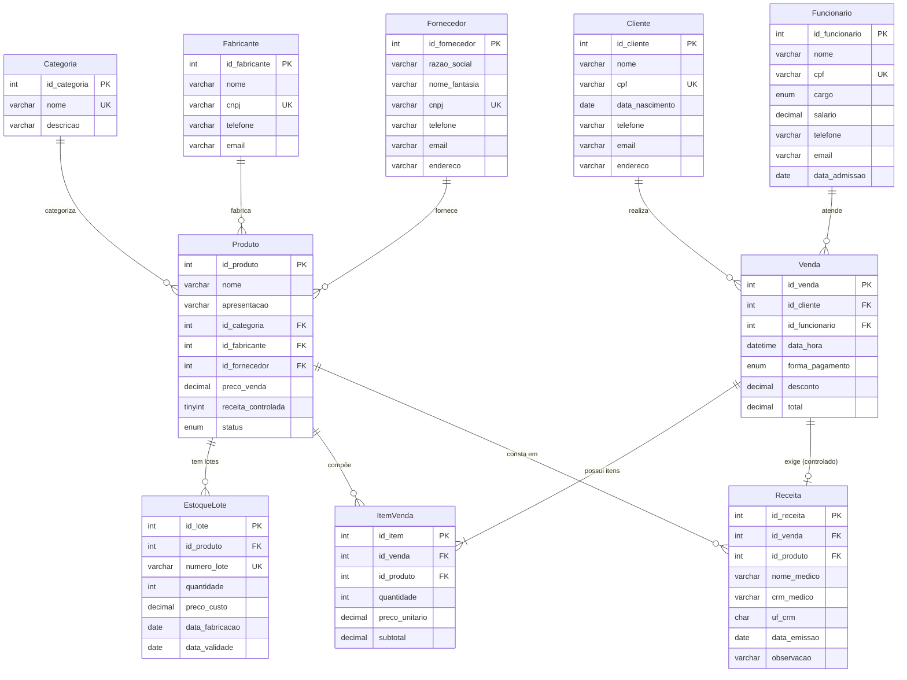
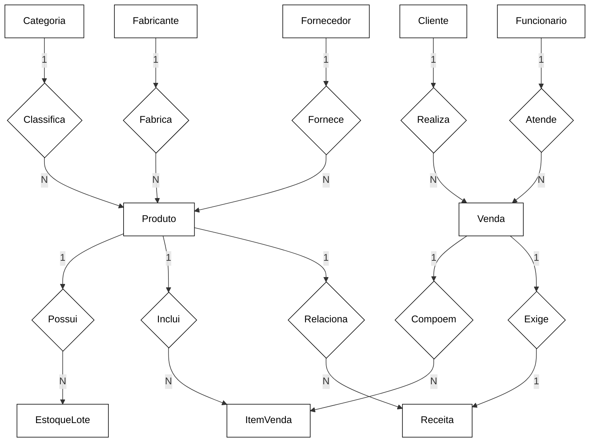

# Farmácia Bem-Estar

Sistema de cadastro e gerenciamento de farmácia com **API REST + interface web**, desenvolvido em **Node.js + Express** com banco de dados **MySQL**, como TDE da disciplina de **Programação em Banco de Dados**.

## Tecnologias

| Tecnologia | Uso |
|---|---|
| **MySQL 9.x** | banco de dados relacional (InnoDB, utf8mb4) |
| **Node.js 18+** | runtime do servidor |
| **Express 5** | API REST |
| **mysql2** | conexão com o banco via pool de conexões |
| **HTML + CSS + JS (vanilla)** | interface web sem framework |
| **Mermaid** | diagramas MER/DER desta documentação |

## Estrutura do Projeto

```
farmacia-bem-estar/
├── db/
│   ├── schema.sql              ← DDL — cria o banco e as 10 tabelas
│   └── seed.sql                ← DML — dados fictícios de demonstração
├── docs/
│   ├── der.mmd / der.png       ← DER (fonte Mermaid + imagem)
│   └── mer.mmd / mer.png       ← MER (fonte Mermaid + imagem)
├── public/
│   ├── index.html              ← página principal (abas do sistema)
│   ├── style.css               ← estilos
│   └── app.js                  ← lógica do front-end (fetch à API)
├── db.js                       ← pool de conexões MySQL (lê o `.env`)
├── server.js                   ← API Express + CRUD + venda transacional + relatórios
├── package.json                ← scripts e dependências
├── .env.example                ← modelo de variáveis de ambiente
└── README.md
```

## Diagramas

### DER — Modelo Lógico (tabelas, PK e FK)



### MER — Modelo Conceitual



> Fonte: `docs/mer.mmd`. Imagem exportada: `docs/mer.png`.

## Conceitos de Banco de Dados Demonstrados

| Conceito | Implementação |
|---|---|
| **Entidades e relacionamentos** | 10 entidades modeladas no MER/DER; relacionamentos N:N resolvidos com tabela associativa |
| **Chave primária** | `AUTO_INCREMENT` + `PRIMARY KEY` em todas as tabelas |
| **Chave estrangeira** | `FOREIGN KEY` com `ON DELETE RESTRICT` e `ON UPDATE CASCADE` |
| **Unicidade** | `UNIQUE` em CPF/CNPJ, nome de categoria e `(id_produto, numero_lote)` |
| **Integridade de domínio** | Constraints `CHECK` (salário > 0, quantidade > 0, total ≥ 0, subtotal ≥ 0, validade ≥ fabricação) |
| **Domínio com ENUM** | `cargo`, `status` e `forma_pagamento` |
| **Relacionamento N:N** | `Produto` × `Venda` via tabela `ItemVenda` (com quantidade, preço e subtotal) |
| **Transação (ACID)** | `POST /api/vendas/registrar` com `BEGIN` / `COMMIT` / `ROLLBACK` |
| **Regra de negócio no banco** | Medicamento controlado exige `Receita` vinculada 1:1 à `Venda` |
| **Relatórios com agregação** | `GROUP BY`/`HAVING`, `SUM`, `COUNT`, `BETWEEN`, FIFO por data de validade |
| **Índices** | Índices em chaves estrangeiras e em `data_validade` |

## Funcionalidades

### Venda (fluxo principal)
- Escolhe **cliente**, **atendente** e **forma de pagamento**.
- Adiciona itens (produto + quantidade) com total recalculado em tempo real.
- Se houver **medicamento controlado**, o formulário de **receita** aparece e é obrigatório.
- Confirmar grava venda + itens + baixa de estoque em transação única.

### Clientes (CRUD)
- Cadastro com nome, CPF, nascimento, telefone, e-mail e endereço.
- Editar e excluir com confirmação; CPF com restrição `UNIQUE`.

### Produtos (CRUD)
- Vinculado a **categoria**, **fabricante** e **fornecedor**.
- Flag `receita_controlada` e status `ativo`/`inativo`.
- Produto inativo é bloqueado na venda.

### Catálogo (listas simples)
- Categorias, fabricantes e fornecedores em tabelas de consulta.

### Estoque (lotes)
- Controle por **lote** com quantidade, custo, fabricação e validade.
- Venda baixa estoque pelo lote **que vence primeiro** (FIFO por validade).

### Receitas
- Lista receitas com médico, CRM/UF, data de emissão e medicamento vinculado.

### Relatórios
- Estoque baixo (< 20 unidades), lotes a vencer em 90 dias e **faturamento por período**.

## Regras de Negócio

| Regra | Onde é validada |
|---|---|
| Venda exige cliente, atendente, forma de pagamento e ao menos 1 item | `POST /api/vendas/registrar` |
| Produto `inativo` não pode ser vendido | consulta de status antes do INSERT |
| Quantidade inválida (≤ 0) é rejeitada | validação do payload |
| Estoque insuficiente ou lote vencido bloqueia a venda | `SELECT` de lote com `data_validade >= CURDATE()` |
| Desconto não pode superar o total | cálculo com `throw` + `ROLLBACK` |
| Medicamento controlado exige receita completa | `INSERT` em `Receita` dentro da transação |

## Persistência

Os dados vivem no **MySQL**. A conexão é um `pool` do `mysql2` (vê `db.js`):

```js
const pool = mysql.createPool({
  host: process.env.DB_HOST || 'localhost',
  port: Number(process.env.DB_PORT || 3306),
  user: process.env.DB_USER || 'farmacia_user',
  password: process.env.DB_PASSWORD || '',
  database: process.env.DB_NAME || 'farmacia_db',
  connectionLimit: 10,
  dateStrings: true,
});
```

A **venda transacional** executa, dentro de `BEGIN`/`COMMIT`:
1. valida produto (existe, ativo, controlado);
2. seleciona o lote com estoque suficiente e validade válida, ordenado por vencimento (FIFO);
3. baixa a quantidade no lote escolhido;
4. insere `Venda` e os `ItemVenda`;
5. se controlado, insere a `Receita`;
6. `COMMIT` (ou `ROLLBACK` em qualquer erro — nada fica pela metade).

## Como Executar

### Requisitos
- Node.js 18+ (`npm`)
- MySQL 8+ (testado no 9.7.2)
- Cliente `mysql` no PATH (apenas para o script `db:setup`)

### Comandos

```bash
# Instalar dependências
npm install

# Criar o banco e popular com dados de exemplo (pede a senha do root)
npm run db:setup

# Subir a API + front-end
npm start

# Verificação de qualidade (ESLint)
npm run lint
```

Acesse **http://localhost:3000**.

Outra forma de criar o banco (sem CLI): no MySQL Workbench, execute `db/schema.sql` e depois `db/seed.sql`. Para refazer a base: `DROP DATABASE farmacia_db;` antes de rodar novamente.

### Configuração (.env)

Copie `.env.example` para `.env` e ajuste:

```
DB_HOST=localhost
DB_PORT=3306
DB_USER=farmacia_user
DB_PASSWORD=sua_senha
DB_NAME=farmacia_db
PORT=3000
```

Crie o usuário com permissão no banco (ou use o `root`):

```sql
CREATE USER 'farmacia_user'@'localhost' IDENTIFIED BY 'sua_senha';
GRANT ALL PRIVILEGES ON farmacia_db.* TO 'farmacia_user'@'localhost';
```

## API HTTP

### CRUD automático
Rotas geradas para `categorias`, `fabricantes`, `fornecedores`, `clientes`, `funcionarios`, `estoque`, `receitas`, `produtos`, `vendas`:

| Método | Rota | Descrição |
|---|---|---|
| GET | `/api/<entidade>` | Lista registros |
| POST | `/api/<entidade>` | Cria registro |
| GET | `/api/<entidade>/:id` | Busca por ID |
| PUT | `/api/<entidade>/:id` | Atualiza registro |
| DELETE | `/api/<entidade>/:id` | Exclui registro |

### Rotas específicas

| Método | Rota | Descrição |
|---|---|---|
| POST | `/api/vendas/registrar` | Venda completa em transação (venda + itens + estoque + receita) |
| GET | `/api/vendas/:id/detalhe` | Venda com itens e receita vinculada |
| GET | `/api/relatorios/estoque-baixo` | Produtos com estoque total < 20 |
| GET | `/api/relatorios/validade-proxima` | Lotes a vencer nos próximos 90 dias |
| GET | `/api/relatorios/vendas-periodo?de=YYYY-MM-DD&ate=YYYY-MM-DD` | Faturamento por dia no período |

## Dados de Exemplo (seed)

O `db/seed.sql` carrega dados fictícios realistas:

| Tabela | Registros |
|---|---|
| Categoria | 11 |
| Fabricante | 10 |
| Fornecedor | 4 |
| Cliente | 8 |
| Funcionario | 5 |
| Produto | 13 |
| EstoqueLote | 13 |
| Venda | 6 |
| ItemVenda | 12 |
| Receita | 2 (Clonazepam e Metilfenidato) |

## Scripts npm

| Script | Comando | O que faz |
|---|---|---|
| `start` | `npm start` | Sobe a API + front em `http://localhost:3000` |
| `lint` | `npm run lint` | Executa o ESLint nos arquivos `.js` |
| `db:setup` | `npm run db:setup` | Cria o banco via `schema.sql` e popula com `seed.sql` (pede a senha do root) |

## Observações

- O `.env` não deve ser versionado (já está no `.gitignore`); use `.env.example` como referência.
- Desenvolvido e validado no Windows + MySQL 9.7.2; a tabela `Funcionario` usa `ENUM` de cargo — portabilidade para outro SGBD exigiria ajustes.
- Os diagramas desta documentação são blocos Mermaid inline (DER: `docs/der.mmd`, MER: `docs/mer.mmd`), exportáveis no [mermaid.live](https://mermaid.live).